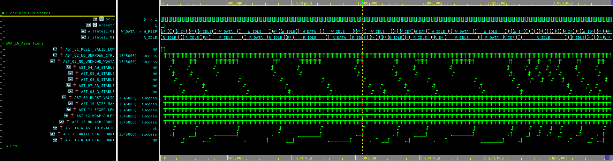
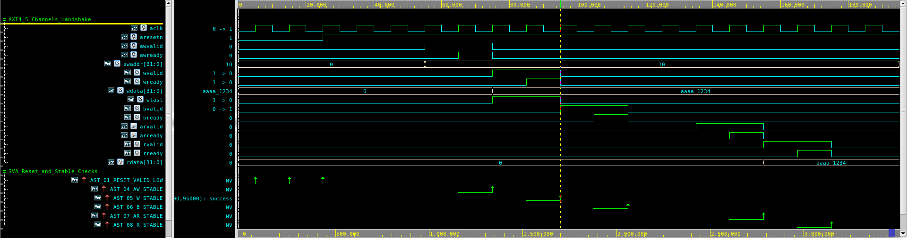
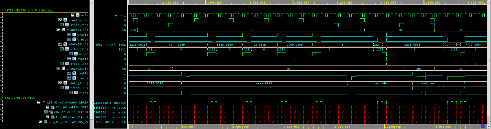

# AXI4-Full SVA Protocol Verification Demo

A 1-week self-study side project exploring the **AMBA AXI4-Full** protocol (reference: ARM IHI 0022) and **SystemVerilog Assertions (SVA)**. The environment pairs a custom 32-bit AXI4-Full Master and Memory Slave with 16 concurrent SVA protocol assertions and 10 functional `cover property` checks, verified across both **Synopsys VCS/Verdi** and **Cadence Xcelium**.

---

## Repository Structure

```text
axi4-full-sva-demo/
├── rtl/
│   ├── axi4_master.sv       # AXI4-Full Master (independent Write and Read FSMs)
│   └── axi4_slave.sv        # AXI4-Full Memory Slave (256x32-bit, FIXED/INCR/WRAP, WSTRB, DECERR)
├── tb/
│   ├── tb_axi4_sva.sv       # Directed testbench: 7 scenarios + 16 SVA assertions + 10 cover properties
│   └── wave_dump.svh        # Dual-vendor waveform dump (FSDB for Verdi / SHM for SimVision)
├── sim/
│   ├── Makefile             # Dual-vendor simulation flow (Synopsys VCS/Verdi/URG & Cadence Xcelium)
│   ├── rtl.f                # RTL filelist
│   └── tb.f                 # Testbench filelist
└── docs/
    ├── AXI4_Full_SVA_vPlan.xlsx # 5-sheet Verification Plan (Summary, SVA Plan, Scenarios, Coverage, Traceability)
    └── waveforms/               # Cropped Verdi nWave screenshots of SVA pass/cover activity
```

---

## Verification Plan & Coverage Matrix

The complete 5-sheet Verification Plan workbook — covering Executive Summary, SVA Assertion Plan (with ARM IHI 0022 section references), Directed Test Scenarios, Functional Coverage rollup, and the Requirements-to-SVA Traceability Matrix — is available in [`docs/AXI4_Full_SVA_vPlan.xlsx`](docs/AXI4_Full_SVA_vPlan.xlsx).

### 1. Directed Test Scenarios (`tb/tb_axi4_sva.sv`)

| Case | Scenario | Transactions Exercised | Key Assertions / Covers Exercised |
| :--- | :--- | :--- | :--- |
| **Case 1** | Single Read & Write | 1-beat (`LEN = 0`) INCR write & read at `0x10` with wait states | `AST_01`, `AST_04`–`AST_08`, `COV_01`, `COV_10` |
| **Case 2** | INCR Bursts | 4-beat (`0x20`) and 16-beat (`0x100`) INCR write & read | `AST_13`, `AST_15`, `AST_16`, `COV_02` |
| **Case 3** | FIXED Bursts | 4-beat and 16-beat max-length FIXED write & read at `0x30` | `AST_11`, `AST_15`, `AST_16`, `COV_03` |
| **Case 4** | WRAP Bursts | All legal WRAP lengths (2, 4, 8, 16 beats) for both write and read | `AST_12`, `AST_15`, `AST_16`, `COV_04`, `COV_05` |
| **Case 5** | Byte-Lane Strobes | `WSTRB` masks `4'b0011`, `4'b1100`, `4'b0101`, `4'b1010`, `4'b0000` at `0x10` | `AST_03`, `COV_06` |
| **Case 6** | Out-of-Range Access | 2-beat write & read at `0x800` (`>= 0x400`) returning `DECERR (2'b11)` | `AST_06`, `AST_08`, `COV_07`, `COV_08` |
| **Case 7** | Full-Duplex Concurrency | Simultaneous 4-beat write & read across all 5 channels at `0x50` | `AST_04`–`AST_08`, `COV_09` |
| **Neg** | Optional Bug Injection | `inject_bug = 1'b1` drives reserved `AWBURST = 2'b11` | Expected fail on `AST_09_BURST_VALID` |

### 2. SVA Protocol Assertions (16 Properties)

| # | Assertion Name | Checked Rule |
| :---: | :--- | :--- |
| 1 | `AST_01_RESET_VALID_LOW` | All five `VALID` signals (`AW`, `W`, `B`, `AR`, `R`) remain low while `aresetn` is asserted. |
| 2 | `AST_02_NO_UNKNOWN_CTRL` | No `X`/`Z` on any `VALID`/`READY` handshake signal out of reset. |
| 3 | `AST_03_NO_UNKNOWN_WDATA` | Active byte lanes of `wdata` (enabled by `wstrb[3:0]`) are not `X`/`Z` when `wvalid` is high. |
| 4 | `AST_04_AW_STABLE` | `awvalid` and `{awaddr, awlen, awsize, awburst}` remain stable while `awvalid && !awready`. |
| 5 | `AST_05_W_STABLE` | `wvalid` and `{wdata, wstrb, wlast}` remain stable while `wvalid && !wready`. |
| 6 | `AST_06_B_STABLE` | `bvalid` and `bresp` remain stable while `bvalid && !bready`. |
| 7 | `AST_07_AR_STABLE` | `arvalid` and `{araddr, arlen, arsize, arburst}` remain stable while `arvalid && !arready`. |
| 8 | `AST_08_R_STABLE` | `rvalid` and `{rdata, rresp, rlast}` remain stable while `rvalid && !rready`. |
| 9 | `AST_09_BURST_VALID` | Reserved burst encoding (`2'b11`) is never driven on `awburst` or `arburst`. |
| 10 | `AST_10_SIZE_MAX` | Transfer size (`1 << awsize` / `1 << arsize`) does not exceed the 32-bit (4-byte) data bus width. |
| 11 | `AST_11_FIXED_LEN` | `FIXED` burst length does not exceed 16 beats (`awlen <= 15`, `arlen <= 15`). |
| 12 | `AST_12_WRAP_RULES` | `WRAP` bursts are word-aligned (`addr[1:0] == 2'b00`) with legal lengths `{2, 4, 8, 16}` beats. |
| 13 | `AST_13_NO_4KB_CROSS` | `INCR` bursts do not cross a 4 KB address boundary. |
| 14 | `AST_14_WLAST_TO_BVALID` | `bvalid` asserts on the cycle following the final write beat (`wvalid && wready && wlast`). |
| 15 | `AST_15_WRITE_BEAT_COUNT` | Local-variable beat counter verifies `wlast` asserts after exactly `awlen + 1` write beats. |
| 16 | `AST_16_READ_BEAT_COUNT` | Local-variable beat counter verifies `rlast` asserts after exactly `arlen + 1` read beats. |

### 3. Functional Cover Properties (10 Properties — VCS Results)

| Cover Property | Target Condition | Observed Matches (345 Attempts) |
| :--- | :--- | :---: |
| `COV_01_SINGLE_RW` | Single-beat write handshake (`awlen == 0`) | 6 |
| `COV_02_BURST_INCR` | 4-beat INCR write handshake | 2 |
| `COV_03_BURST_FIXED` | FIXED write burst handshake | 2 |
| `COV_04_BURST_WRAP_W` | WRAP write burst handshake | 4 |
| `COV_05_BURST_WRAP_R` | WRAP read burst handshake | 4 |
| `COV_06_NARROW_STRB` | Partial byte-lane write strobe (`wstrb == 4'b0011`) | 1 |
| `COV_07_WRITE_DECERR` | Write response returning `DECERR (2'b11)` | 1 |
| `COV_08_READ_DECERR` | Read response returning `DECERR (2'b11)` | 2 |
| `COV_09_SIMULTANEOUS_RW` | Concurrent active write and read data channels (`wvalid && rvalid`) | 5 |
| `COV_10_WAIT_STATES_ALL` | Multi-channel wait-state sequence across `AW -> W -> B` | 16 |

---

## Waveform Verification (Synopsys Verdi)

### Overview of All 16 SVA Assertions


### Case 1: Reset & Channel Stability Across Wait States


### Cases 5–7: Byte Strobes (`WSTRB`), `DECERR`, and Full-Duplex Concurrency


---

## How to Run

Ensure Synopsys (`vcs`, `verdi`, `urg`) or Cadence (`xrun`, `simvision`) tools are available in `PATH`:

```bash
cd sim

# Synopsys VCS + Verdi
make vcs_run
make vcs_verdi

# Cadence Xcelium
make cad_run
```

---

## Scope & Known Limitations

This repository was written as a focused learning exercise for AXI4 protocol handshaking and SVA fundamentals, with the following intentional simplifications and known limitations:

- **AXI4-Full Subset:** 32-bit fixed-size (`SIZE = 2`, 4 bytes/beat), single-outstanding, in-order transactions without transaction IDs (`AWID`/`BID`/`ARID`/`RID`), narrow/unaligned transfers, `W`-before-`AW` ordering, or `QOS`/`CACHE`/`PROT` sideband signals.
- **Protocol-Focused Testbench:** SVA properties check bus protocol compliance, while `rdata`/`bresp` values are observed via simulation logs and waveforms rather than a standalone reference-model scoreboard.
- **Implementation-Coupled Assertions:** `AST_14_WLAST_TO_BVALID` (`|=> bvalid`) and the cycle-bounded repetition in `AST_15`/`AST_16` (`[*1:256]`) are scoped to this master/slave timing model rather than arbitrary multi-cycle slave latencies or same-cycle `AW`/`W` handshakes.
- **Future Improvements:** Separating the SVA rules into a standalone `bind`-able protocol checker module, adding a self-checking memory reference model, and expanding negative tests across all assertion categories.
